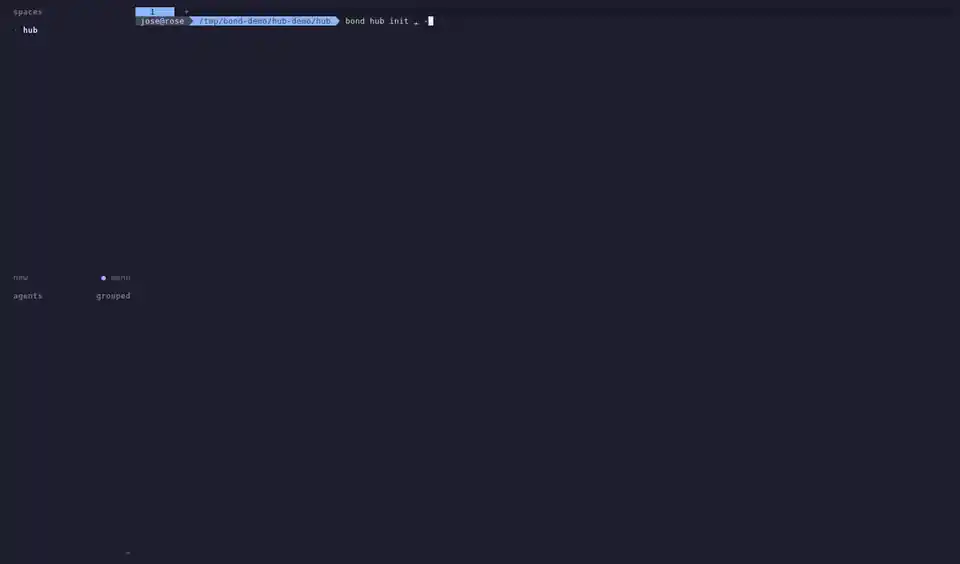

<p align="center">
  <a href="https://josecorral.dev/bond/en/">
    <picture>
      <source media="(prefers-color-scheme: dark)" srcset="docs/public/logo-dark.png">
      
    </picture>
  </a>
</p>

<p align="center"><b>Your coding agents, working together.</b> · <i>007 · licence to code</i></p>

<p align="center"><b>English</b> · <a href="README.es.md">Español</a></p>

<p align="center">
  <a href="https://github.com/jmanuelcorral/bond/actions/workflows/ci.yml"></a>
  <a href="https://github.com/jmanuelcorral/bond/releases/latest"></a>
  <a href="https://github.com/jmanuelcorral/bond/releases"></a>
  <a href="https://github.com/jmanuelcorral/homebrew-tap"></a>
  
  <a href="LICENSE"></a>
  <a href="https://josecorral.dev/bond/en/"></a>
</p>

**bond** is a CLI for working with several coding agents at once: pi, Claude Code, Codex,
Copilot CLI, opencode, Crush, Gemini CLI and Antigravity, coordinated with
**[Herdr](https://herdr.dev)**. None of them is required: one is enough.

<p align="center">
  <a href="https://josecorral.dev/bond/en/whats-new"></a>
  <br>
  <sub><b>New in 1.10.0, hub mode:</b> a pi orchestrator splits a story between a frontend and a backend, one agent per repo. <a href="https://josecorral.dev/bond/en/whats-new">Full video and what's new →</a></sub>
</p>

## In three commands

```bash
bond setup      # once per machine: Herdr, model endpoints, which agents you work with
bond init       # once per repo: which agents to integrate, the default one, which tools
bond            # every day, inside the repo: Herdr with the default agent (gru)
```

- **`bond setup`** checks Herdr (and tells you how to install it if it is missing), detects
  Ollama and LM Studio, lets you add OpenAI or any compatible endpoint (such as your own
  gateway) and brings those models to the agents that can use them. You pick your agents and a
  default one; your instructions (`~/.bond/AGENTS.md`) reach all of them. Everything lives in
  `~/.bond/`, keys with 600 permissions.
- **`bond init`** generates each chosen agent's config in the repo (instructions, MCP servers,
  skills, commands) from a single `.bond/bond.toml`, without overwriting what you wrote by hand.
  With pi, also the **Bond Extensions** (status footer, header, `repo_map`, `/delegate`, `/team`).
- **`bond`** opens the workstation in Herdr. If it already exists, it focuses it; if you are
  already in it, it opens the default agent in that pane. `bond --agent claude`,
  `bond --worktree feat/x` and `bond team feat/a feat/b:claude` for more agents at once.

## Documentation

On the web: **[josecorral.dev/bond/en](https://josecorral.dev/bond/en/)**, in English and in
[Spanish](https://josecorral.dev/bond/) (the same `docs/en/` and `docs/`, with search). In the
repo:

| Doc | What for |
|---|---|
| [docs/en/whats-new.md](docs/en/whats-new.md) | What is new in each release; in 1.10.0, hub mode (with video) |
| [docs/en/getting-started.md](docs/en/getting-started.md) | From zero to working: install, setup, first repo, daily loop, glossary |
| [docs/en/workstation.md](docs/en/workstation.md) | `bond`, `bond team`, `bond status`: workspaces, agents, worktrees, teams |
| [docs/en/reference.md](docs/en/reference.md) | Reference: every command, what it generates for each agent and why |
| [docs/en/troubleshooting.md](docs/en/troubleshooting.md) | Quick diagnosis (`bond doctor`) and common errors |
| [CHANGELOG.md](CHANGELOG.md) | Changes per release (in Spanish) |

## Install

```sh
# Linux and macOS
curl -fsSL https://raw.githubusercontent.com/jmanuelcorral/bond/main/install.sh | sh

# Homebrew (macOS and Linux)
brew install jmanuelcorral/tap/bond
```

```powershell
# Windows
powershell -ExecutionPolicy Bypass -c "irm https://raw.githubusercontent.com/jmanuelcorral/bond/main/install.ps1 | iex"
```

The installers download the binary from the [latest release](https://github.com/jmanuelcorral/bond/releases/latest)
and check its SHA-256. Then: `bond setup`. To update: `bond update`.

From source (Node 22.18 or later): `git clone https://github.com/jmanuelcorral/bond && cd bond && npm ci --ignore-scripts && bin/bond setup`.

The CLI speaks Spanish for now (messages and help); the documentation is in both languages.

## Multi-agent

| What | How |
|---|---|
| Another agent instead of the default one | `bond --agent claude` |
| Work in a worktree | `bond --worktree feat/x --base main` (uses `herdr worktree`) |
| A team, one agent per branch | `bond team feat/a feat/b:claude --base main`: inside Herdr, minions in panes of your tab |
| How each branch is going, send it work, collect | `bond team status`, `bond team prompt feat/a "…"`, `bond team clean` |
| See what each one is doing | `bond status`; `bond sessions` to resume pi sessions |
| Delegate to another agent from an agent | `bond-delegate` skill: in pi `/delegate reviewer:claude review the diff`; in Claude or Copilot `/bond-delegate …` |
| A hub: an operations repo with other repos (submodule or symlink) | `bond hub init` creates it and imports the repos into `repos/`; `bond hub check`, `bond hub pull` and `bond team fix/x` (one vertical branch, one agent per repo) |
| Split a task across worktrees from an agent | `bond-team` skill: in pi `/team <task>`; it proposes the split, waits for your OK and sums up per branch |

`bond-delegate` and `bond-team` are global skills: any agent can delegate to any other. Everything
follows the rules of the `herdr` skill: Herdr is only used when you ask for it, unique names, no
automatic merge, push or cleanup, and nobody answers an agent's questions for you.

## Hub mode

A **hub** is an operations repo that groups other repos (as submodules or as symlinks to your
clones) and works on them vertically: a branch with the same name in all of them and one agent
per repo, coordinated from the hub.

```bash
bond hub init                    # creates the hub, imports the repos into repos/ and runs bond init in them
bond hub check                   # what each repo is missing and how to fix it (--fix)
bond hub pull                    # brings each repo's base up to date (fast-forward only)
bond team fix/login              # a vertical branch: one worktree and one agent per repo
bond team prompt fix/login "login fails with uppercase emails"
bond team collect fix/login --repo backend && bond team clean fix/login
```

The session lives in `hub.toml`, and the hub's `AGENTS.md` carries a generated block with the
repos and the hub's rules for the orchestrator. Details in [What's new](docs/en/whats-new.md) and
in the [reference](docs/en/reference.md#bond-hub).

## Workflow with skills

`bond init` can install skills in the repo that take a task from the issue to the release. Each
step shows what it is going to write or publish and waits for your OK:

refine the issue → plan in phases → run a phase → commit → PR → release

`code-context`, `git-conventional-commit` (used by `/commit`), `plan-create` and `plan-execute`
come selected; `issue-refine-github`, `delivery-review-github`, `release-prepare-github` (all
three need GitHub), `convention-document` and `plan-team` are optional. `plan-team` runs the
independent phases of a plan in parallel, one `bond team` branch per phase. Details in
[docs/en/reference.md](docs/en/reference.md#catalog-skills).

## Context layer

So that the agent understands a repo by reading as little as possible: pi's native search tools
(`grep`, `find`, `ls`), the `repo_map` tool (a map of the repo in ~40 lines), library docs by
version (`context7` MCP), web search (`duckduckgo` MCP), `ast-grep` and the `code-context` skill.
Details and reasons in [docs/en/reference.md](docs/en/reference.md#context-layer).

```bash
pi mcp list            # check the MCP servers
```

## Development

```bash
npm ci --ignore-scripts          # dependencies (and TypeScript to check types)
bin/bond <command>               # bond from source (Node >= 22.18)
npm run typecheck && bun test    # types and tests (test/)
bun scripts/build.mts            # dist/: Linux, macOS and Windows binaries + npm package
```

The binary embeds the catalog, the global skills and the Bond Extensions, and extracts them the
first time into `~/.bond/runtime/<version>/`. CI (`.github/workflows/ci.yml`) checks types, runs
the tests, builds it and tests the binary on Linux, macOS and Windows. Contributions follow
[AGENTS.md](AGENTS.md) (in Spanish).

## Layout

```
bond/
├── bin/bond                      # entry point (checks Node and loads cli/)
├── cli/                          # the CLI (TypeScript .mts, run from the repo without building)
│   ├── main.mts                  # subcommands
│   ├── setup.mts, wizard.mts     # bond setup
│   ├── repo.mts                  # bond init, bond sync
│   ├── catalog.mts               # bond catalog (create, check, add, list, update, remove, clean)
│   ├── catalog-git.mts           # catalogs over git: refs, cache and .bond/lock.json
│   ├── launch.mts, herdr.mts     # bond, bond dev, bond status
│   ├── team.mts                  # bond team (status, prompt, collect, clean)
│   ├── hub.mts, hub-init.mts     # bond hub: the session (hub.toml), init, add, sync
│   ├── hub-check.mts, hub-pull.mts   # bond hub check and bond hub pull
│   ├── sessions.mts              # bond sessions
│   ├── decisions.mts             # bond decisions: the decision memory and its runs
│   ├── trust.mts                 # agents' trust in bond team worktrees
│   ├── update.mts                # bond update
│   ├── config.mts, keys.mts      # ~/.bond: config.toml, keys
│   ├── endpoints.mts, models.mts, agents.mts, run.mts   # endpoints and models per agent
│   ├── instructions.mts          # each agent's global instructions
│   ├── catalog-agents.mts        # known agents and how to install them
│   ├── doctor.mts, suggestions.mts, migrate.mts, runtime.mts, util.mts
├── catalog/                      # what bond init installs in a repo
│   ├── catalog.toml              # name, summary of each skill and whether it comes selected
│   ├── skills/                   # code-context, plan-create, plan-execute...
│   ├── commands/                 # review, commit, handoff (common syntax)
│   └── mcps/                     # MCP servers, one per file: context7, duckduckgo
├── templates/catalog/            # what bond catalog create writes in a new catalog
├── global/skills/                # bond-delegate, bond-team (global, for any agent)
├── assets/                       # the README's animated preview
├── extensions/, prompts/, lib/   # pi's Bond Extensions (package: package.json → "pi")
├── scripts/build.mts             # binaries and npm package
├── docs/                         # the documentation, docs/en/ in English (also on GitHub Pages)
├── site/                         # the docs/ site with VitePress (.github/workflows/pages.yml)
└── .github/workflows/ci.yml      # builds and tests on Linux, macOS and Windows
```

`herdr/config.snippet.toml` is applied by `bond setup --herdr-config`; `scripts/pi-resources`
lists what pi really loads in a directory (for debugging).

## License

[MIT](LICENSE). The status footer and `bond sessions` start from ideas in
[Jeyapaul/pi](https://github.com/Jeyapaul/pi) (MIT).
