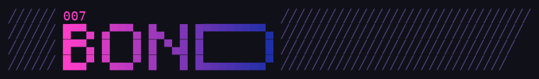

# BOND



<details><summary>El logo en texto</summary>

```
╱╱╱╱╱╱ 007                        ╱╱╱╱╱╱╱╱╱╱╱╱╱╱╱╱╱╱╱╱╱╱╱╱╱╱╱╱╱╱
╱╱╱╱╱╱ █▀▀▄ ▄▀▀▀▄ █▄  █ █▀▀▀▀▀▀▀▄ ╱╱╱╱╱╱╱╱╱╱╱╱╱╱╱╱╱╱╱╱╱╱╱╱╱╱╱╱╱
╱╱╱╱╱╱ █▀▀▄ █   █ █ ▀▄█ █       █ ╱╱╱╱╱╱╱╱╱╱╱╱╱╱╱╱╱╱╱╱╱╱╱╱╱╱╱╱
╱╱╱╱╱╱ █▄▄▀ ▀▄▄▄▀ █   █ █▄▄▄▄▄▄▄▀ ╱╱╱╱╱╱╱╱╱╱╱╱╱╱╱╱╱╱╱╱╱╱╱╱╱╱╱
```

</details>

**BOND** (*007 · licence to code*) es una CLI para trabajar con varios agentes de código a la
vez: pi, Claude Code, Codex, Copilot CLI, opencode, Crush y Gemini CLI, coordinados con
**[Herdr](https://herdr.dev)**. Ninguno es obligatorio: basta con tener uno.

## En tres comandos

```bash
bond setup      # una vez por máquina: Herdr, endpoints de modelos, con qué agentes trabajas
bond init       # una vez por repo: qué agentes integrar, cuál por defecto, qué herramientas
bond            # cada día, dentro del repo: Herdr con el agente por defecto y una shell
```

- **`bond setup`** comprueba Herdr (y te dice cómo instalarlo si falta), detecta Ollama y LM
  Studio, te deja añadir OpenAI o cualquier endpoint compatible (como una pasarela propia) y
  lleva esos modelos a los agentes que pueden usarlos. Eliges tus agentes y uno por defecto;
  tus instrucciones (`~/.bond/AGENTS.md`) llegan a todos. Todo queda en `~/.bond/`, las claves
  con permisos 600.
- **`bond init`** genera la config de cada agente elegido en el repo (instrucciones, servidores
  MCP, skills, comandos) desde un único `.bond/bond.toml`, sin pisar lo que tengas a mano. Con pi,
  además las **Bond Extensions** (pie de estado, cabecera, `repo_map`, `/delegate`, `/team`).
- **`bond`** abre el puesto de trabajo en Herdr. Si ya existe, lo enfoca. `bond --agent claude`,
  `bond --worktree feat/x` y `bond team . feat/a feat/b:claude` para más agentes a la vez.

## Documentación

| Doc | Para qué |
|---|---|
| [docs/getting-started.md](docs/getting-started.md) | De cero a trabajar: instalación, setup, primer repo, bucle diario, glosario |
| [docs/puesto.md](docs/puesto.md) | `bond`, `bond team`, `bond status`: workspaces, agentes, worktrees, equipos |
| [docs/reference.md](docs/reference.md) | Referencia: cada comando, qué genera para cada agente y por qué |
| [docs/troubleshooting.md](docs/troubleshooting.md) | Diagnóstico rápido (`bond doctor`) y errores habituales |
| [docs/plan-v1.md](docs/plan-v1.md) | Hoja de ruta hasta la 1.0 |
| [CHANGELOG.md](CHANGELOG.md) | Cambios por versión |

## Instalación

```sh
# Linux y macOS
curl -fsSL https://raw.githubusercontent.com/jmanuelcorral/bond/main/install.sh | sh

# Homebrew (macOS y Linux)
brew install jmanuelcorral/tap/bond
```

```powershell
# Windows
powershell -ExecutionPolicy Bypass -c "irm https://raw.githubusercontent.com/jmanuelcorral/bond/main/install.ps1 | iex"
```

Los instaladores descargan el binario de la [última release](https://github.com/jmanuelcorral/bond/releases/latest)
y comprueban su SHA-256. Después: `bond setup`.

Desde el código (Node 22.18 o más): `git clone https://github.com/jmanuelcorral/bond && cd bond && npm ci --ignore-scripts && bin/bond setup`.

## Multiagente

| Qué | Cómo |
|---|---|
| Otro agente en vez del de por defecto | `bond --agent claude` |
| Trabajar en un worktree | `bond --worktree feat/x --base main` (usa `herdr worktree`) |
| Un equipo, un agente por rama | `bond team . feat/a feat/b:claude --base main` |
| Ver qué hace cada uno | `bond status`; `bond sessions` para retomar sesiones de pi |
| Delegar en otro agente desde un agente | Skill `bond-delegate`: en pi `/delegate reviewer:claude revisa el diff`; en Claude o Copilot `/bond-delegate …` |
| Repartir una tarea entre worktrees desde un agente | Skill `bond-team`: en pi `/team <tarea>`; propone el reparto, espera tu OK y resume por rama |

`bond-delegate` y `bond-team` son skills globales: cualquier agente puede delegar en cualquier
otro. Todo respeta las reglas del skill `herdr`: Herdr solo se usa cuando lo pides, nombres
únicos, nada de merge, push ni limpieza automática, y nadie responde por ti a las preguntas de
un agente.

## Capa de contexto

Para que el agente entienda un repo leyendo lo mínimo: tools de búsqueda nativas de pi
(`grep`, `find`, `ls`), la tool `repo_map` (mapa del repo en ~40 líneas), documentación de
librerías por versión (MCP `context7`), búsqueda web (MCP `duckduckgo`), `ast-grep` y el
skill `code-context`. Detalle y porqués en [docs/reference.md](docs/reference.md#capa-de-contexto).

```bash
pi mcp list            # comprobar los servidores MCP
```

## Desarrollo

```bash
npm ci --ignore-scripts          # dependencias (smol-toml)
bin/bond <comando>               # bond desde el código fuente (Node >= 22.18)
bun scripts/build.mts            # dist/: binarios de Linux, macOS y Windows + paquete de npm
```

El binario lleva dentro el catálogo, los skills globales y las Bond Extensions, y los extrae
la primera vez en `~/.bond/runtime/<versión>/`. CI (`.github/workflows/ci.yml`) lo compila y
prueba en Linux, macOS y Windows. Hoja de ruta: [docs/plan-v1.md](docs/plan-v1.md).

## Estructura

```
bond/
├── bin/bond                      # punto de entrada (comprueba Node y carga cli/)
├── cli/                          # la CLI (TypeScript .mts, sin compilar desde el repo)
│   ├── main.mts                  # subcomandos
│   ├── setup.mts, wizard.mts     # bond setup
│   ├── repo.mts                  # bond init, bond sync
│   ├── launch.mts, herdr.mts     # bond, bond dev, bond team, bond status
│   ├── sessions.mts              # bond sessions
│   ├── config.mts, keys.mts      # ~/.bond: config.toml, claves
│   ├── endpoints.mts, models.mts, agents.mts, run.mts   # endpoints y modelos por agente
│   ├── instructions.mts          # instrucciones globales de cada agente
│   ├── catalog-agents.mts        # agentes conocidos y cómo instalarlos
│   ├── doctor.mts, runtime.mts, util.mts
├── catalog/                      # lo que bond init instala en un repo
│   ├── mcp.json                  # servidores MCP: context7, duckduckgo
│   ├── skills/code-context/
│   └── commands/                 # review, commit, handoff (sintaxis común)
├── global/skills/                # bond-delegate, bond-team (globales, para cualquier agente)
├── extensions/, prompts/, lib/   # Bond Extensions de pi (paquete: package.json → "pi")
├── scripts/build.mts             # binarios y paquete de npm
├── docs/
└── .github/workflows/ci.yml      # compila y prueba en Linux, macOS y Windows
```

`herdr/config.snippet.toml` lo aplica `bond setup --herdr-config`; `scripts/pi-resources` lista
lo que pi carga de verdad en un directorio (para depurar).

## Licencia

[MIT](LICENSE). El pie de estado y `bond sessions` parten de ideas de
[Jeyapaul/pi](https://github.com/Jeyapaul/pi) (MIT).
